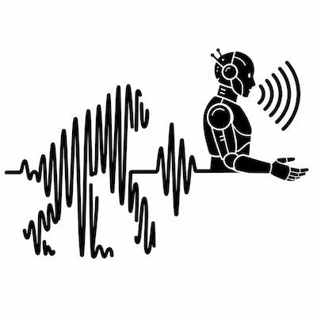
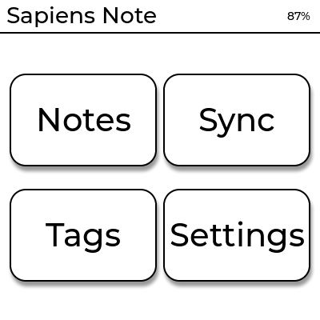
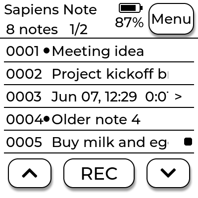
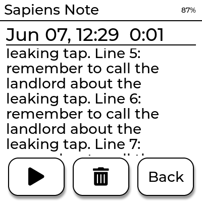
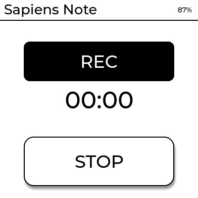

<p align="center">
  
</p>

<h1 align="center">Sapiens Note</h1>

<p align="center">
  <strong>A minimalist, distraction-free AI voice-note device.</strong><br>
  Press one button, speak your idea, pocket it. Later it's transcribed and there to
  read on the device — without ever opening a phone.
</p>

<p align="center">
  
  
  
  
  
  
</p>

---

Sapiens Note is inspired by [Pala Note](https://circuitdigest.com/news/pala-note-a-pocket-sized-ai-voice-note-device)
and built on the **Waveshare ESP32-S3 1.54" e-Paper (touch)** board. It ships as
**one experience in several forms that all share a single C++ core**, so the
device, the desktop simulators, and the firmware behave identically:

| | What it is |
|---|---|
| 🎛️ **Device** | The physical e-ink gadget you carry (ESP-IDF firmware). |
| 🖥️ **Simulator** | A pixel-accurate desktop app — *no hardware required*. |
| 🧩 **LVGL Simulator** | The same UI rebuilt with real LVGL 9 widgets. |
| 🌐 **Web dashboard** | A local e-ink-styled page to play, download & transcribe. |

---

## 📸 The interface

<table>
  <tr>
    <td align="center"><br><sub><b>Home menu</b> — 4 big buttons</sub></td>
    <td align="center"><br><sub><b>Recordings</b> — counter, battery, paging</sub></td>
  </tr>
  <tr>
    <td align="center"><br><sub><b>Transcript</b> — full text, auto-scroll</sub></td>
    <td align="center"><br><sub><b>Recording</b> — big timer + STOP</sub></td>
  </tr>
</table>

Black-and-white, high-contrast, rounded "raised" buttons with an **e-ink
color-invert** flash on tap — the desktop simulator mirrors the real panel.

---

## ✨ Features

**On the device / simulator**

- 🎙️ **One-tap capture** — record 16 kHz mono audio; stored locally first.
- ▶️ **Built-in player** — play / pause / stop with a progress bar.
- 🗂️ **Recordings list** — per-row counter (`0001…`), live battery icon, **5-per-page** pagination, marquee for long titles.
- 📝 **Full transcript view** — fills the screen and **auto-scrolls infinitely** (exits the top, re-enters from the bottom) at the speed set in Settings; **tap to pause/resume**.
- 🏠 **Home menu** — Notes · Sync · Tags · Settings, with the e-ink invert effect on tap.
- ⏱️ **Splash animation** — the name types out letter-by-letter, then blinks (4 s).
- ⚙️ **Settings** — scroll speed and 5 date-time name formats.
- 🗑️ **Delete with confirmation** · ⭐ favorites · 🏷️ tags.
- 🔌 **Offline-first** — capture never needs the network.

**On the web dashboard (`sapiens-web`)** — reads the *same* local database

- ▶️ Play each recording in the browser, with a live **audio spectrum** on the playing tile.
- ⬇️ **Download** the `.wav` (shows file size) and the transcript `.txt`.
- 🗣️➡️📄 **Transcribe / re-transcribe** per recording, with an **in-progress bar** and a **confirm popup** before overwriting an existing transcript.
- 🗑️ **Delete** with the same confirmation as the device.
- 🔁 Results flow straight back into the simulator (shared DB, live refresh).

---

## 🚀 Quick start

> No Python, no cloud account required to get going. Everything is C++ + CMake.
> Data lives in `~/.sapiensnote-sim/` (`sapiensnote.db` + `audio/`), shared by every app.

### 1. The desktop simulator

```bash
cmake -B build -S . -DCMAKE_BUILD_TYPE=Release
cmake --build build -j
./build/simulator/sapiens-sim          # window: click = tap, R = record, Esc = back, Q = quit
ctest --test-dir build              # run the test suite
```

### 2. The LVGL simulator (same UI, real widgets)

```bash
cmake -B build-lvgl -S . -DSAPIENS_WITH_LVGL=ON          # fetches LVGL 9
cmake --build build-lvgl --target sapiens-sim-lvgl -j
./build-lvgl/simulator_lvgl/sapiens-sim-lvgl
```

### 3. The web dashboard

```bash
cmake -B build -S . -DSAPIENS_WITH_WEB=ON                 # fetches cpp-httplib
cmake --build build --target sapiens-web -j
./build/webtool/sapiens-web                                # → http://127.0.0.1:8080
```

### 4. Or just build everything with Docker

```bash
docker build -t sapiensnote .                           # builds core + tests + CLI + simulator, runs ctest
```

---

## 🧠 Transcription

The ESP32-S3 can't run speech recognition itself, so transcription happens
off-device. `sapiens-web` (or its headless `--once` mode) turns recordings into text
via a **pluggable engine** and writes the result back through the shared core, so
it appears in the simulator too.

| Engine | Flag | Needs |
|---|---|---|
| **whisper.cpp** (local, offline) | `--engine whisper` *(default)* | `SAPIENS_WHISPER_MODEL=/path/ggml-base.bin` (+ `whisper-cli` on `PATH`) |
| **OpenAI Whisper API** (cloud) | `--engine openai` | `OPENAI_API_KEY` |
| **fake** (demo) | `--engine fake` | nothing — writes placeholder text to try the flow |

```bash
# offline
SAPIENS_WHISPER_MODEL=~/models/ggml-base.bin ./build/webtool/sapiens-web
# cloud
OPENAI_API_KEY=sk-… ./build/webtool/sapiens-web --engine openai
# headless: transcribe everything pending, then exit
./build/webtool/sapiens-web --once
```

**The loop:** record in the simulator → open `sapiens-web` → press transcribe → the
transcript shows on the web page **and** in the note on the device/simulator.

---

## 🏗️ Architecture

One portable C++ core drives every client through a thin Hardware Abstraction
Layer (HAL). Each platform only implements display, input, audio, and storage.

```
              ┌──────────────────────────────────────────────┐
              │           Shared C++ core  (core/)           │
              │ AppController · NoteService · AudioService   │
              │ Sync client · domain models · HAL interfaces │
              └───────────────────────┬──────────────────────┘
                                      │
       ┌──────────────────┬───────────┴────────┬────────────────────┐
       ▼                  ▼                    ▼                    ▼
┌─────────────┐   ┌──────────────┐   ┌──────────────────┐   ┌───────────────┐
│ Firmware    │   │ sapiens-sim  │   │ sapiens-sim-lvgl │   │ sapiens-web   │
│ (ESP-IDF)   │   │ SDL2 +       │   │ LVGL 9 +         │   │ cpp-httplib + │
│ e-paper HAL │   │ 1-bit Canvas │   │ SDL2             │   │ pluggable ASR │
└─────────────┘   └──────────────┘   └──────────────────┘   └───────────────┘

The three desktop apps share  ~/.sapiensnote-sim/sapiensnote.db  +  audio/
```

- **Offline-first** — capture works with no network; transcription is the only
  step that reaches out, and only when you ask for it.
- **One experience** — every client is a thin shell around one shared C++ core.
- **Personal** — a single user, all data local; no accounts, teams, or multi-tenancy.

---

## 📦 Project layout

```
core/            shared C++ library (domain, HAL, services, SyncClient) + host/ impls
storage/         SQLite-backed repository (sapiensstore)
simulator/       SDL2 desktop app — 1-bit Canvas + baked AA fonts + Renderer + SdlAudio
simulator_lvgl/  the same UI on LVGL 9 widgets (opt-in: -DSAPIENS_WITH_LVGL=ON)
webtool/         sapiens-web — local e-ink dashboard + pluggable transcribers (opt-in)
firmware/        ESP-IDF project (scaffold) reusing the core + renderer
cli/             headless demo that drives the core end-to-end
tests/           CTest suites (core, sqlite, sync)
tools/           genfont.cpp — bakes a TTF into an anti-aliased C++ font header
docs/            full specification set (architecture, hardware, API, ADRs…)
assets/ logos/   screenshots and branding
```

---

## 📚 Documentation

Full design lives in **[docs/](docs/)** — start with
[ARCHITECTURE.md](docs/ARCHITECTURE.md),
[HARDWARE.md](docs/HARDWARE.md), and the [ADRs](docs/ADR/). Build details are in
[BUILD.md](BUILD.md).

---

## 🔧 Requirements

- A **C++23** compiler and **CMake ≥ 3.20**
- **SDL2** + **SQLite3** (desktop simulator & storage)
- *Optional:* network access to fetch **LVGL 9** (`-DSAPIENS_WITH_LVGL=ON`) and
  **cpp-httplib** (`-DSAPIENS_WITH_WEB=ON`); **libcurl** enables the OpenAI engine
- *Optional:* **whisper.cpp** + a ggml model for offline transcription

---

<p align="center"><sub>
Hardware: <a href="https://docs.waveshare.com/ESP32-S3-ePaper-1.54?variant=ESP32-S3-Touch-ePaper-1.54">Waveshare ESP32-S3-Touch-ePaper-1.54</a> ·
200×200 monochrome e-paper · ES8311 mic + speaker · Wi-Fi/BLE · microSD · Li-battery.
</sub></p>
